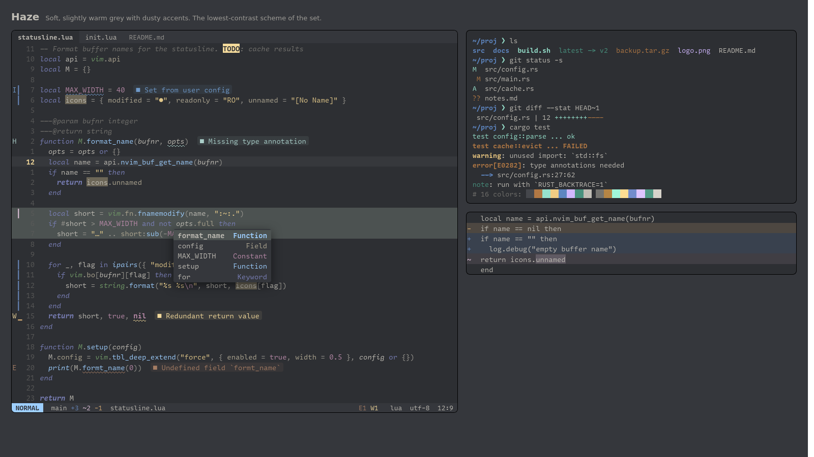
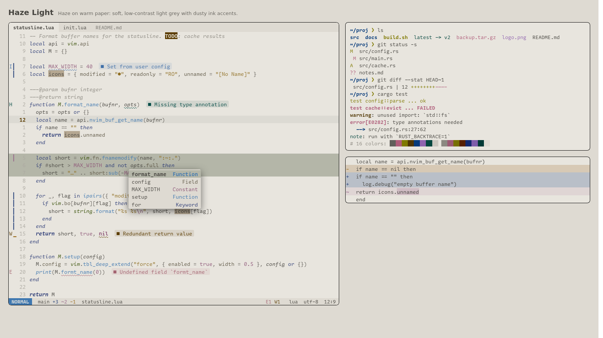
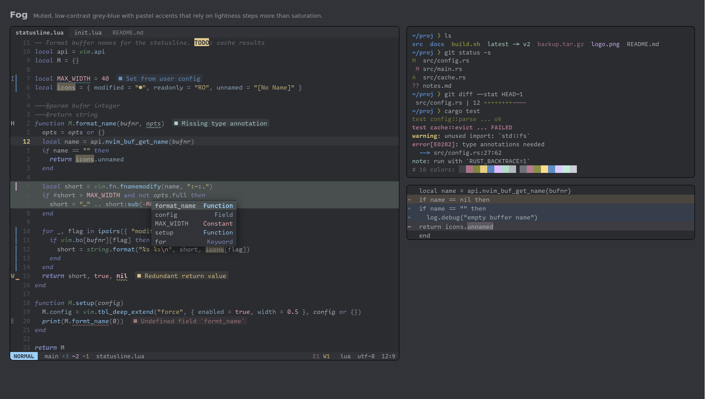
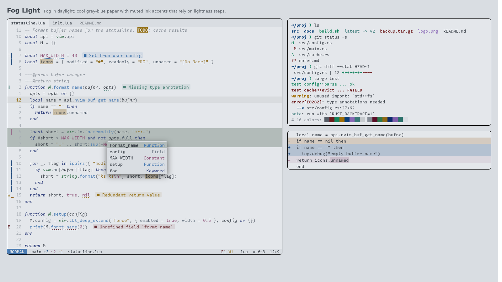
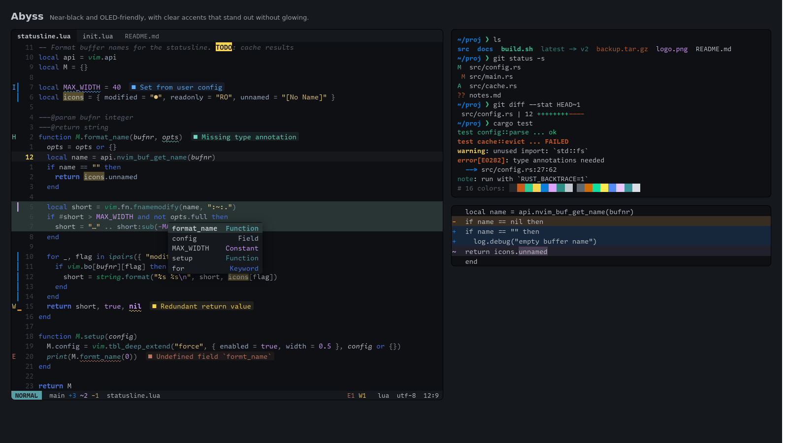
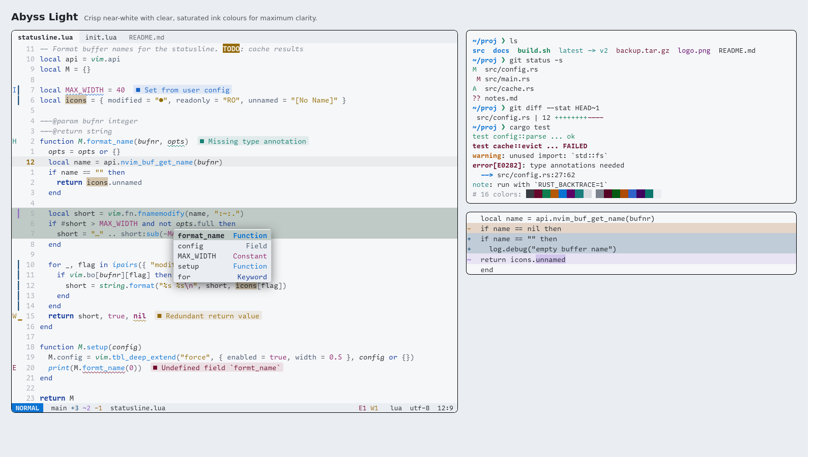
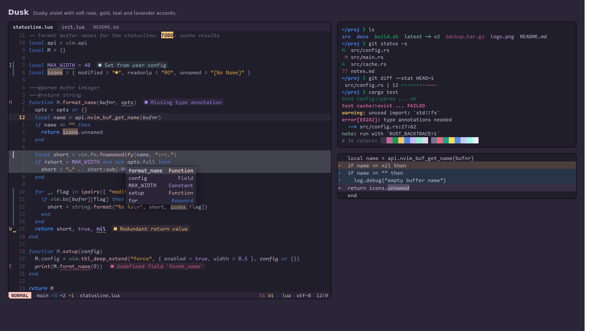
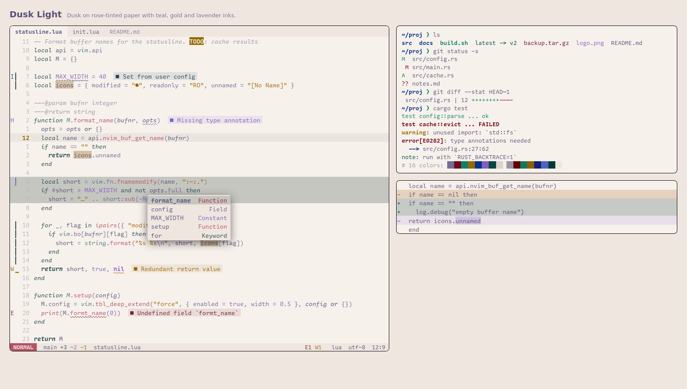

# clearsight

Colourschemes for **red-green colour blindness (strong deutan)**, optimised against a deutan vision model
(Machado 2009 simulation, severity 1.0; colour differences in CIEDE2000).
Every syntax role, diagnostic, git sign and terminal colour sits where a deuteranope can still tell it apart,
while the palettes stay calm and good-looking for everyone.

| Scheme | Variant | Character | Text contrast | Syntax distinctions kept¹ | Closest core pair² | Error vs warning² | Added vs deleted² | Terminal worst pair² |
|---|---|---|---|---|---|---|---|---|
| **Haze** | dark | muted, low-contrast, warm-grey | 7.1:1 | 100% | 14.4 | 24.9 | 44.8 | 19.4 |
| **Fog** | dark | muted, low-contrast, cool-grey | 7.0:1 | 100% | 11.9 | 24.9 | 43.5 | 18.7 |
| **Abyss** | dark | near-black, oled, high-clarity | 11.2:1 | 98% | 16.9 | 25.1 | 62.5 | 20.6 |
| **Dusk** | dark | soft, violet | 11.5:1 | 100% | 14.7 | 25.0 | 51.4 | 20.4 |
| **Haze Light** | light | muted, low-contrast, warm-grey | 7.7:1 | 100% | 15.4 | 25.1 | 53.1 | 19.7 |
| **Fog Light** | light | muted, low-contrast, cool-grey | 8.1:1 | 90% | 13.6 | 25.1 | 51.0 | 14.8 |
| **Abyss Light** | light | high-clarity, crisp | 14.7:1 | 90% | 16.7 | 25.2 | 51.9 | 17.5 |
| **Dusk Light** | light | soft, rose | 6.5:1 | 100% | 11.8 | 25.3 | 36.9 | 19.0 |

¹ Share of the role pairs a scheme intends to differ that still differ in deutan vision.
² CIEDE2000 between simulated colours (≥ 15 comfortable, 10–15 fine, < 5 easily confused).

## Previews

Editor (treesitter, diagnostics, git signs, completion), terminal and diff, rendered from each scheme's `colorschemes.json`.

### Haze

| Dark | Light |
|---|---|
|  |  |

### Fog

| Dark | Light |
|---|---|
|  |  |

### Abyss

| Dark | Light |
|---|---|
|  |  |

### Dusk

| Dark | Light |
|---|---|
|  |  |

## Install

```sh
git clone https://github.com/b4skyx/colorschemes ~/.local/share/colorschemes
```
The paths below assume that location; adjust them if you clone elsewhere.

### Neovim (lazy.nvim)
```lua
{
  "b4skyx/colorschemes",
  name = "clearsight",
  lazy = false,
  priority = 1000,
  opts = {                 -- all optional
    transparent = false,
    italics = true,
    bold = true,
    terminal_colors = true,
    on_highlights = function(groups, palette) end,   -- tweak groups before they are applied
    overrides = {},         -- { GroupName = { fg = "#hex", ... } }
  },
  config = function(_, opts)
    require("clearsight").setup(opts)
    vim.cmd.colorscheme("haze")   -- haze fog abyss dusk, and each with -light
  end,
}
```
lualine: `require("lualine").setup({ options = { theme = "haze" } })`.
Vim: put the repo on `runtimepath` and run `:colorscheme haze` (the same `colors/*.vim` files work in Vim).

### Terminals and CLI tools
Replace `haze` with any scheme folder.

| Tool | File | How |
|---|---|---|
| Alacritty | `haze/alacritty.toml` | `[general] import = ["~/.local/share/colorschemes/haze/alacritty.toml"]` |
| kitty | `haze/kitty.conf` | `include ~/.local/share/colorschemes/haze/kitty.conf` |
| WezTerm | `haze/wezterm.toml` | add the folder to `color_scheme_dirs`, set `color_scheme = "Haze"` |
| Ghostty | `haze/ghostty` | copy to `~/.config/ghostty/themes/Haze`, set `theme = Haze` |
| Rio | `haze/rio.toml` | copy to `~/.config/rio/themes/haze.toml`, set `theme = "haze"` |
| tmux | `haze/tmux.conf` | `source-file ~/.local/share/colorschemes/haze/tmux.conf`; palette available as `#{@clearsight_accent}` etc. |
| fish | `haze/fish.theme` | copy to `~/.config/fish/themes/Haze.theme`, then `fish_config theme save Haze` |
| starship | `haze/starship.toml` | merge into `starship.toml`, set `palette = "haze"` |
| fzf | `haze/fzf.sh`, `haze/fzf.fish` | `source` it from your shell config |
| delta | `haze/delta.gitconfig` | `[include] path = ~/.local/share/colorschemes/haze/delta.gitconfig`, then `[delta] features = clearsight-haze` |
| lazygit | `haze/lazygit.yml` | merge the `gui.theme` block into `~/.config/lazygit/config.yml` |
| eza | `haze/eza.yml` | copy to `~/.config/eza/theme.yml` (or point `EZA_CONFIG_DIR` at a folder containing it) |
| yazi | `haze/yazi/haze.yazi/` | copy to `~/.config/yazi/flavors/`, set `[flavor] dark = "haze"` in `theme.toml` |

## How it's built
Everything except `<id>/recipe.toml` and `<id>/colorschemes.json` is **generated** by
[colorscheme-tools](https://github.com/b4skyx/colorscheme-tools) (`cstools`) from `colorschemes.json`, the single source of truth:

```sh
pip install git+https://github.com/b4skyx/colorscheme-tools   # provides `cstools`
cstools build .            # regenerate every target listed in colorschemes.toml
cstools build . --check    # CI: fail if generated files are stale
cstools validate */colorschemes.json
cstools score haze/colorschemes.json
cstools inspect haze/colorschemes.json   # which roles use each base colour
cstools optimize haze/recipe.toml -o haze/colorschemes.json   # re-run the design optimiser (changes colours)
cstools gallery . -o /tmp/gallery --screenshots assets/previews   # refresh the preview images (needs Firefox)
```

`colorschemes.json` stores each colour **once** in `palette` (readable names such as `blue_deep`, `sand`);
roles, terminal colours and derived colours (cursorline, selection, diff backgrounds) are references or formulas.
Change a base colour, run `cstools build .`, and every target follows.

## License
MIT
